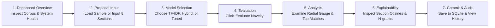

# Academic Project Novelty Detection System
## Final Demonstration & Viva Presentation Guide

This guide provides step-by-step instructions for demonstrating the Academic Project Novelty Detection platform during academic viva examinations, project demonstrations, and evaluation panels.

---

## 1. System Requirements & Environment Setup

- **Operating System**: Windows 10/11, macOS, or Linux
- **Python**: Version 3.10+ (Current: Python 3.12)
- **Node.js**: Version 18+ (Current: Node.js 20+)
- **Storage**: SQLite 3 (built-in with Python)
- **Memory**: Minimum 4 GB RAM (8 GB recommended for sentence-transformers in memory)

---

## 2. Starting the Application

The application consists of two communicating processes:
1. **FastAPI Backend Service** (port `8000`)
2. **React 19 Frontend Dashboard** (port `5173`)

### Terminal 1: Launch FastAPI Backend
From the repository root (`c:\Users\rajes\OneDrive\Desktop\PBL\academic-project-novelty-detection`):
```powershell
python -m uvicorn src.api.main:app --host 127.0.0.1 --port 8000 --reload
```
*Expected Terminal Output:*
```
INFO:     Started server process [XXXX]
INFO:     Waiting for application startup.
INFO:     Application startup complete.
INFO:     Uvicorn running on http://127.0.0.1:8000 (Press CTRL+C to quit)
```

Verify backend health in your browser or curl:
```powershell
curl http://127.0.0.1:8000/api/health
```
*(Returns reference corpus size: 600, active scoring mode: `tfidf`, available scoring modes: `['tfidf', 'hybrid', 'tuned_hybrid']`)*

### Terminal 2: Launch React Frontend Dashboard
In a second terminal window:
```powershell
npm --prefix frontend run dev
```
*Expected Terminal Output:*
```
  VITE v8.3.5  ready in 320 ms

  ➜  Local:   http://localhost:5173/
  ➜  Network: use --host to expose
```
Open **`http://localhost:5173`** in Google Chrome or any modern web browser.

---

## 3. End-to-End User Demonstration Workflow



### Step 1: Dashboard Overview
1. Navigate to `http://localhost:5173`.
2. Notice the top KPI stat cards:
   - **Reference Corpus**: `600` historical projects.
   - **Submitted Proposals**: Real-time count of user proposals saved in SQLite.
   - **Service Status**: Green `Healthy` indicator (models preloaded in RAM).
   - **Evaluation Pipeline**: `TF-IDF + Ridge` (active production default).
3. The **Corpus Status Card** displays active explainable AI indicators and summary disclaimers.

### Step 2: Load or Input a Candidate Proposal
1. Click the **"Evaluate New Proposal"** button (or navigate to the **Evaluate** tab).
2. Use the **Preset Demo Selector** dropdown in the top right banner to preload demonstration cases, or manually paste the example proposal below.

#### Example Test Proposal: Near-Duplicate Crop Disease Project
- **Project Title**: `Automated Foliar Crop Disease Identification Using Deep Convolutional Networks`
- **Domain**: `Artificial Intelligence & Machine Learning`
- **Abstract**: `This project develops an automated vision framework for detecting foliar crop diseases across agricultural leaf imagery. The system utilizes convolutional neural networks to classify PlantVillage benchmarks and generate actionable decision support.`
- **Problem Statement**: `Manual crop inspection is error-prone and labor-intensive for rural farming communities, leading to delayed disease identification and harvest yield losses.`
- **Objectives**: `1) Preprocess foliar leaf dataset; 2) train convolutional neural network classifier; 3) benchmark classification accuracy; 4) evaluate runtime inference latency.`
- **Proposed Methodology**: `Construct an end-to-end vision classification pipeline comparing dual convolutional architectures on standardized agricultural benchmark imagery.`
- **Dataset**: `PlantVillage`
- **Algorithm / Model**: `Convolutional Neural Network (CNN)`
- **Technology Tools**: `Python, PyTorch, Scikit-learn, OpenCV`

### Step 3: Switch Scoring Engine Models
Directly above the 8 proposal fields is the **Scoring Model Architecture** selector:
1. **TF-IDF Baseline (Default)**:
   - Evaluates pure n-gram vocabulary matching.
   - Click to test baseline linear Ridge behavior.
2. **Hybrid Baseline ($\alpha=0.50$)**:
   - Equal 50/50 convex blend of lexical TF-IDF and dense embeddings.
3. **Tuned Hybrid ($\alpha=0.60$)** *(Recommended)*:
   - Phase 5 calibrated model (60% TF-IDF + 40% Semantic).
   - Click this card to engage the tuned model.

### Step 4: Evaluate Novelty
1. Click the purple **"Evaluate Novelty"** button.
2. In ~300ms, the evaluation completes and the UI automatically switches to the **Novelty & Explainability Report** tab.

### Step 5: Interpret Novelty & Similarity Scores
1. **Radial Novelty Gauge**:
   - Displays overall novelty score percentage: $(1 - \frac{\hat{y}_{\max}}{4.0}) \times 100\%$.
   - For the near-duplicate example above, similarity is $\approx 3.9$ / 4.0, yielding a Novelty Score of $\approx 2.5\%$, triggering the red badge: **`Low Novelty (High Similarity / Near-Duplicate)`**.
2. **Evaluation Model Badge**:
   - Displays the active model used (e.g. `Tuned Hybrid (α=0.60)`).
   - Displays the exact mathematical formula:
     $$\text{tuned\_hybrid\_similarity} = 0.60 \times s^{\text{lex}} + 0.40 \times s^{\text{sem}}$$
     $$\hat{y} = \sum w_i \cdot s_i^{\text{tuned}}$$
3. **Top Historical Match**:
   - Directly displays the closest historical match ID (`SYN-0001: Prototype Crop Disease Detection Using CNN`).

### Step 6: Inspect Section-Wise Explainability
1. **Section Breakdown Chart**:
   - Compare lexical vs semantic overlap across all 8 text sections.
   - Notice that **Dataset** (`PlantVillage`) and **Title** show near $1.0$ similarity.
2. **Additive Linear Contribution**:
   - Shows that **Dataset** accounts for $48.8\%$ ($w=1.9529$) of the score, and **Title** accounts for $23.8\%$ ($w=0.9535$).
3. **Verified Keyword Evidence**:
   - Expand the `#1 Top Match Card` to see exact shared phrases highlighted:
     - *"crop disease detection"*
     - *"plantvillage"*
     - *"convolutional neural networks"*
   - Context snippets quote the exact surrounding sentences from both the candidate proposal and historical reference project.

### Step 7: Commit Proposal to Database
1. In the **Save Evaluated Proposal** card, click **"Save Proposal"**.
2. The proposal is committed to SQLite and assigned a persistent project ID (e.g. `SUB-0002`).
3. Click **"View in History"** to inspect the audit log. The submitted proposal now appears in the search and audit table.

---

## 4. Comparing the Three Models During Viva

Demonstrate how the three models handle **paraphrased projects**:
1. Load **Preset: Case C (Strong Paraphrase)**:
   - Uses alternate vocabulary: *"Deep Vision Architecture for Automated Agricultural Pathology Recognition"* over *"foliar leaf collections"*.
2. Run with **TF-IDF Baseline**:
   - Pure lexical matching misses the conceptual similarity because wording differs. Similarity remains low (~1.1 / 4.0).
3. Run with **Tuned Hybrid ($\alpha=0.60$)**:
   - The dense transformer embeddings identify that *"agricultural pathology"* is semantically identical to *"crop disease detection"*.
   - Predicted similarity rises appropriately, correctly alerting faculty to conceptual redundancy.

---

## 5. Common Errors and Solutions

| Symptom | Probable Cause | Corrective Action |
|---|---|---|
| **Frontend displays "Could not connect to FastAPI backend"** | Backend process is not running on port 8000. | In Terminal 1, run `python -m uvicorn src.api.main:app --port 8000`. |
| **"Evaluation Request Failed: 8 sections required"** | One or more input fields were left empty or too short. | Fill all 8 fields or click "Preset: Demo Sample" to populate them. |
| **"Proposal content was changed after scoring"** | Fields were edited after evaluation report was generated. | Click "Evaluate Novelty" to refresh the analysis before saving. |
| **Duplicate Proposal Warning (HTTP 409)** | A proposal with the identical title or text was already saved. | Change the project title or test with a new proposal scenario. |

