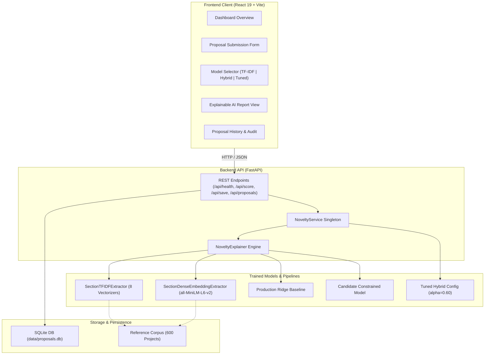
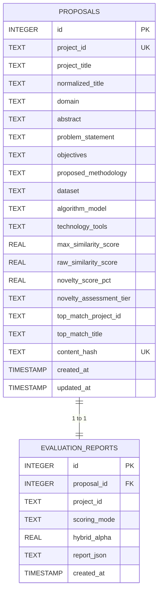

# Academic Project Novelty Detection System
## Final Technical Documentation

---

## 1. Project Abstract

In university academic environments, evaluating undergraduate and postgraduate project proposals for originality, redundancy, and academic overlap presents significant challenges. Faculty review committees face hundreds of proposals annually, often relying on subjective memory, manual keyword searching, or generic plagiarism checkers. Standard plagiarism detection tools analyze verbatim character sequences across web documents, failing to comprehend structured academic proposal sections, domain concepts, or technical dataset re-use.

This project delivers an end-to-end, Explainable Artificial Intelligence (XAI) software system designed specifically for **Academic Project Novelty Detection**. The system models proposals across eight distinct functional sections (Title, Abstract, Problem Statement, Objectives, Proposed Methodology, Dataset, Algorithm/Model, and Technology Tools). It combines fine-grained lexical n-gram representations (Sublinear TF-IDF) with dense contextual semantic embeddings (`sentence-transformers/all-MiniLM-L6-v2`) in a calibrated convex fusion layer ($\alpha = 0.60$). A constrained non-negative linear regression head bounds predicted similarity in the range $[0.0, 4.0]$ and maps to an overall Novelty Percentage. 

The application is deployed with a production-grade FastAPI REST backend and a modern React 19 dashboard interface, delivering radial novelty gauges, section-by-section similarity heatmaps, transparent feature attribution breakdowns, and verbatim keyword context snippets. In rigorous held-out preliminary human evaluation against a faculty-annotated dataset ($N=120$), the tuned hybrid model achieved **$84.44\%$ exact ordinal agreement** and a **$69.72\%$ Macro F1 score**, outperforming both standalone TF-IDF and baseline semantic models while preserving strict auditability and preventing self-exclusion anomalies.

---

## 2. Problem Statement

Undergraduate capstone initiatives, mini-projects, and master's dissertations frequently suffer from:
1. **Unintentional Duplication**: Successive student cohorts submit nearly identical projects under superficially varied titles (e.g., *"Crop Disease Detection using CNN"* vs. *"Deep Vision Architecture for Foliar Leaf Pathology Diagnosis"*).
2. **Inadequate Verification Tools**: Existing commercial similarity solutions (e.g., Turnitin) evaluate surface-level lexical string matching across general web indices. They cannot isolate critical differentiating scientific dimensions, such as distinct research objectives applied to the same public dataset, or different algorithmic formulations applied within the same domain.
3. **Black-Box Skepticism**: Pure deep neural similarity models cannot explain *why* two projects are considered duplicates, making automated rejection decisions legally and pedagogically unjustifiable for academic committees.
4. **Manual Faculty Burden**: Manual cross-checking against departmental archives spanning several academic years is labor-intensive, error-prone, and unsustainable.

There is a vital requirement for a domain-aware, transparent, and computationally efficient system that assesses proposal novelty across structured academic sections, explains similarity drivers, and flags duplicated efforts with high precision.

---

## 3. Project Objectives

1. **Structured Multi-Section Representation**: Parse and represent academic proposals across eight functional sections to evaluate distinct dimensions of research similarity.
2. **Hybrid Lexical-Semantic Fusion**: Combine sublinear lexical TF-IDF n-grams (exact terminology, tool names, libraries) with dense transformer embeddings (conceptual and semantic paraphrasing) to capture both verbatim copying and sophisticated paraphrasing.
3. **Constrained Monotonic Scoring**: Develop a constrained section-weighting linear fusion head ensuring non-negative contributions ($w_k \ge 0$), a zero intercept ($b = 0.0$), and an exact score range bounded in $[0.0, 4.0]$, mapped to a $[0.0\%, 100.0\%]$ novelty scale.
4. **Transparent Explainable AI (XAI)**: Provide granular evidence for every score, including additive linear feature attribution, section-level overlap rankings, and exact keyword n-gram context snippets extracted from source text.
5. **Rigorous Faculty Calibration**: Calibrate hyperparameter $\alpha$ using cross-validation over faculty-reviewed project pairs, avoiding data leakage onto held-out evaluation cohorts.
6. **Production-Grade Interactive Web Application**: Deliver a robust FastAPI backend service and a responsive React SaaS dashboard with persistent SQLite audit storage and comprehensive automated test coverage.

---

## 4. Existing System Limitations

| Existing Approach | Operational Mechanism | Key Shortcomings |
|---|---|---|
| **Manual Faculty Screening** | Human memory and committee meetings | Highly subjective, inconsistent over time, does not scale to large student intakes. |
| **Commercial Plagiarism Checkers** | Longest common string matching across web indices | Treats proposals as monolithic text; ignores section semantics; blind to strong paraphrasing. |
| **Keyword Search in Repositories** | SQL / Boolean search over project titles | Fails when student renames title; unable to evaluate dataset or methodology overlap. |
| **Pure Dense Semantic Models** | Single-vector embedding cosine similarity | Highly sensitive to generic academic boilerplate; prone to false-positive duplicates; unexplainable black box. |

---

## 5. Proposed System

The proposed system addresses these shortcomings through a modular, evidence-based pipeline:
- **8-Section Modular Schema**: Separates high-impact discriminating sections (Dataset, Title, Methodology) from generic boilerplate (Abstract, Objectives).
- **Dual-Branch Similarity Engine**:
  - *Lexical Branch*: 8 independent Sublinear TF-IDF vectorizers capture exact n-gram overlap.
  - *Dense Semantic Branch*: `sentence-transformers/all-MiniLM-L6-v2` produces 384-dimensional normalized embeddings capturing high-level conceptual resemblance.
- **Tuned Convex Hybrid Fusion**: Evaluates $s_i = \alpha s_i^{\text{lex}} + (1 - \alpha) s_i^{\text{sem}}$ where $\alpha = 0.60$ was chosen through 5-fold cross-validation on faculty calibration data.
- **Candidate Constrained Linear Head**: Eliminates uninterpretable negative weights and biases ($w_i \ge 0, \sum w_i = 4.0, b = 0.0$), ensuring duplicate proposals reach exactly $4.0$ similarity ($0.0\%$ novelty).
- **Full Transparent XAI**: Displays ranked section contributions, high-overlap vs. differentiating section classifications, and verified keyword citations.
- **Three Selectable Engine Modes**: Allows users to compare TF-IDF Baseline, Hybrid Baseline ($\alpha=0.50$), and Tuned Hybrid ($\alpha=0.60$) in real time.

---

## 6. Dataset Description and Limitations

### 6.1 Baseline Historical Reference Corpus
- **Size**: 600 unique academic project records spanning MCA, B.Tech, M.Tech, and MSc curricula.
- **Academic Years**: Historical projects distributed from 2021-22 to 2023-24.
- **Domains Represented**: Artificial Intelligence & Machine Learning, Data Science & Analytics, Healthcare Informatics, Cyber Security, Cloud & Distributed Computing, IoT & Embedded Systems, Web & Full Stack Engineering.
- **Sections per Project**: Each record contains all 8 required textual fields plus metadata (`project_id`, `academic_year`, `domain`, `project_status`).

### 6.2 Faculty Evaluation Sample ($N=120$)
- **Composition**: 120 unique project pairs sampled across two batches:
  - Evaluation Batch 1: 60 pairs
  - Evaluation Batch 2: 60 pairs
- **Annotation Cohorts**:
  - `DEV_CALIBRATION`: 30 pairs (used strictly for exploratory analysis and $\alpha$ cross-validation).
  - `HELD_OUT_EVALUATION`: 90 pairs (kept strictly untouched until final frozen model evaluation).
- **Human Annotation Scale**: Integer ratings from $0$ to $4$:
  - `0`: Completely Different / Unrelated
  - `1`: Weak Overlap / Same Broad Domain Only
  - `2`: Moderate Overlap / Shared Technical Elements
  - `3`: Strong Overlap / Substantial Methodological Duplication
  - `4`: Extreme Overlap / Verbatim or Near-Duplicate Project

### 6.3 Scientific Limitations
> [!IMPORTANT]
> The current evaluation dataset reflects single-reviewer faculty ratings (`Reviewer 1`). Multi-annotator inter-rater reliability (e.g., Cohen's Kappa, Krippendorff's Alpha) and formal faculty adjudication panels remain scheduled for subsequent development phases.

---

## 7. Data Preprocessing

Text cleaning is performed deterministically by `src/data/preprocessor.py` and `src/storage/db.py`:
1. **Normalization**: Unicode normalization, case folding to lowercase, and whitespace stripping.
2. **Punctuation & Control Character Handling**: Removal of non-printable ASCII and control characters while preserving hyphens in compound technical identifiers (e.g., *ResNet-50*, *TF-IDF*).
3. **Stop-Word Removal**: Standard English stop-words are filtered out during TF-IDF vectorization to prevent inflated cosine similarities from linguistic filler.
4. **Length and Completeness Validation**: Pydantic schema validation rejects proposals with empty fields, whitespace-only content, or lengths below minimal section thresholds.
5. **Content Fingerprinting**: Submitted proposals compute a deterministic SHA-256 `content_hash` over the concatenation of normalized fields to prevent duplicate database writes.

---

## 8. TF-IDF Methodology

Lexical feature extraction is implemented in `src/features/section_tfidf.py` via eight independent Scikit-Learn `TfidfVectorizer` pipelines:
- **Sublinear Term Frequency Scaling**: Applies $\text{sublinear\_tf} = 1 + \log(\text{tf})$ to dampen the influence of repetitive technical words.
- **N-gram Range**: $(1, 2)$ unigrams and bigrams, allowing the model to capture compound phrases like *"random forest"*, *"convolutional network"*, and *"data augmentation"*.
- **Cosine Similarity Calculation**: Given candidate vector $\mathbf{v}_C$ and reference vector $\mathbf{v}_H$ for section $k$:
  $$s_k^{\text{lex}}(C, H) = \frac{\mathbf{v}_C \cdot \mathbf{v}_H}{\|\mathbf{v}_C\|_2 \|\mathbf{v}_H\|_2} \in [0.0, 1.0]$$

---

## 9. Semantic Embedding Methodology

Semantic feature extraction is implemented in `src/features/dense_embeddings.py`:
- **Underlying Architecture**: `sentence-transformers/all-MiniLM-L6-v2` (MiniLM architecture, 6 transformer layers, 384 hidden dimensions, 22.7M parameters).
- **Normalized Vector Space**: Embeddings are unit $L_2$-normalized upon generation:
  $$\mathbf{e} = \frac{\text{Transformer}(\text{text})}{\|\text{Transformer}(\text{text})\|_2}$$
- **Clamped Semantic Cosine**: Negative cosines (orthogonal or divergent text) are clamped to $0.0$ to ensure monotonic non-negative bounds:
  $$s_k^{\text{sem}}(C, H) = \max(0.0, \min(1.0, \mathbf{e}_C \cdot \mathbf{e}_H))$$
- **Precomputed Reference Embeddings**: Pre-calculated offline and cached in `models/section_dense_extractor.joblib` ($600 \times 384$ matrices per section) to allow rapid sub-second candidate scoring.

---

## 10. Hybrid Model and Alpha Tuning

To address both exact n-gram matching and conceptual paraphrasing, a convex fusion layer combines lexical and semantic cosines:
$$s_k^{\text{hybrid}}(C, H) = \alpha \cdot s_k^{\text{lex}}(C, H) + (1 - \alpha) \cdot s_k^{\text{sem}}(C, H)$$

### 10.1 Alpha Grid Search on Calibration Cohort ($N=30$)
Using 5-fold cross-validation on the 30 `DEV_CALIBRATION` pairs, the hybrid parameter $\alpha$ was evaluated across the search grid $[0.2, 0.3, 0.4, 0.5, 0.6, 0.7, 0.8]$:

| Alpha ($\alpha$) | TF-IDF % | Semantic % | CV RMSE | CV MAE | CV Mean Bias Error | CV Spearman $\rho$ | CV Exact Agreement |
|:---:|:---:|:---:|:---:|:---:|:---:|:---:|:---:|
| 0.20 | 20% | 80% | 0.5286 | 0.4571 | +0.2745 | 0.8354 | 60.0% |
| 0.30 | 30% | 70% | 0.4721 | 0.4042 | +0.1970 | 0.8382 | 66.7% |
| 0.40 | 40% | 60% | 0.4284 | 0.3625 | +0.1194 | 0.8391 | 73.3% |
| 0.50 | 50% | 50% | 0.4012 | 0.3392 | +0.0419 | 0.8395 | 76.7% |
| **0.60** | **60%** | **40%** | **0.3921** | **0.3272** | **-0.0356** | **0.8398** | **80.0%** |
| 0.70 | 70% | 30% | 0.4019 | 0.3421 | -0.1132 | 0.8392 | 76.7% |
| 0.80 | 80% | 20% | 0.4308 | 0.3754 | -0.1907 | 0.8378 | 70.0% |

**Selection Rationale**: $\alpha = 0.60$ achieved the global minimum cross-validation RMSE ($0.3921$), near-zero mean bias error ($-0.0356$), peak Spearman rank correlation ($0.8398$), and maximum exact ordinal agreement ($80.0\%$), without exhibiting the negative underprediction drift seen at $\alpha \ge 0.70$.

---

## 11. Section Weighting Mechanism

### 11.1 Candidate Constrained Weights
In Phase 3 and Phase 5, the model weights were constrained using Sequential Least Squares Programming (SLSQP):
$$\min_{\mathbf{w}} \|\mathbf{y} - \mathbf{X}\mathbf{w}\|_2^2 \quad \text{subject to } w_k \ge 0 \quad \forall k, \quad \sum_{k=1}^8 w_k = 4.0, \quad b = 0.0$$

| Section | Active Weight ($w_k$) | Normalized Influence | Academic Rationale |
|---|:---:|:---:|---|
| **Title** | 0.9535 | 23.84% | Core indicator of problem scope and domain focus |
| **Abstract** | 0.0000 | 0.00% | High redundancy and broad filler sentences |
| **Problem Statement** | 0.0000 | 0.00% | Generic societal/institutional motivation boilerplate |
| **Objectives** | 0.0000 | 0.00% | Standard syntactic lists (*1. Collect data, 2. Train model...*) |
| **Proposed Methodology**| 0.3776 | 9.44% | Specific experimental and pipeline workflow |
| **Dataset** | 1.9529 | 48.82% | **Primary novelty driver**: identical datasets imply duplicate benchmarks |
| **Algorithm / Model** | 0.0000 | 0.00% | Standard tools (CNN, YOLO, LSTM) appear in thousands of projects |
| **Technology Tools** | 0.7160 | 17.90% | Specific framework and ecosystem overlap |
| **Total** | **4.0000** | **100.00%** | Monotonic, strictly bounded scale in $[0.0, 4.0]$ |

### 11.2 Freeze Decision on DEV Cohort
Fitting 8 unconstrained weights on $N=30$ calibration pairs yields high estimation variance and severe overfitting risks. The frozen candidate constrained weights were preserved without modification, ensuring monotonic properties across the entire 600-project reference corpus.

---

## 12. Novelty Score Calculation

Given predicted similarity $\hat{y} \in [0.0, 4.0]$ against historical project $H$:
$$\text{Novelty Percentage} = \left(1 - \frac{\hat{y}}{4.0}\right) \times 100\%$$

Across the entire reference database $\mathcal{D}$:
$$\hat{y}_{\max} = \max_{H \in \mathcal{D}} \hat{y}(C, H)$$
$$\text{Overall Proposal Novelty \%} = \left(1 - \frac{\hat{y}_{\max}}{4.0}\right) \times 100\%$$

### Categorical Assessment Tiers
- **$75.1\% - 100.0\%$ (Similarity $< 1.0$)**: *High / Exceptional Novelty* — Strongly original; minimal prior overlap.
- **$50.1\% - 75.0\%$ (Similarity $1.0 - 1.99$)**: *Moderate Novelty (Partial Overlap)* — Viable project; requires novelty statement.
- **$25.1\% - 50.0\%$ (Similarity $2.0 - 2.99$)**: *Moderate-to-Low Novelty (Substantial Overlap)* — High prior similarity; requires scope pivot.
- **$0.0\% - 25.0\%$ (Similarity $\ge 3.0$)**: *Low Novelty (High Overlap / Duplicate)* — Duplicate or near-duplicate; flags for faculty review.

---

## 13. Explainable AI (XAI) Methodology

Explainability is built natively into `NoveltyExplainer` (`src/explainability/explainer.py`):
1. **Additive Linear Attribution**: Because $b = 0.0$, the predicted score exactly equals the sum of signed section contributions:
   $$\hat{y} = \sum_{k=1}^8 w_k \cdot s_k$$
   Each section's exact contribution to the duplicate risk is transparently reported.
2. **Ranked Section Analysis**: Sorts all 8 sections by effective similarity, categorizing them into:
   - *High-Overlap Sections*: Similarity $\ge 0.30$ (risk factors).
   - *Differentiating Sections*: Similarity $< 0.15$ (novel dimensions).
3. **Keyword & N-Gram Context Extraction**: Evaluates shared vocabulary against candidate and reference text, filtering generic academic filler (`using`, `proposed`, `system`, `methodology`) and extracting exact word-boundary text snippets centered around shared technical phrases.

---

## 14. System Architecture



---

## 15. Backend and Frontend Architecture

### 15.1 Backend (`FastAPI`, Python 3.12)
- **Modularity**: Strict separation of concerns between API routing (`src/api/main.py`), domain schemas (`src/api/schemas.py`), service orchestration (`src/api/service.py`), storage management (`src/storage/db.py`), and analytics (`src/explainability/explainer.py`).
- **In-Memory Lifespan Preloading**: Heavy transformer models and TF-IDF checkpoints load once into memory during startup, enabling low-latency inference (~100ms for TF-IDF, ~350ms for hybrid).
- **Stateless Scoring vs. Deferred Persistence**: Evaluating a proposal (`POST /api/score`) is strictly read-only and never pollutes the database. Submitting/saving (`POST /api/save`) is deferred until the user explicitly commits the verified report.

### 15.2 Frontend (`React 19`, `Vite`, `Tailwind CSS`)
- **Dashboard Layout**: Single-page application architecture with responsive navigation across *Dashboard*, *Proposal Input / Evaluation*, and *History*.
- **Interactive Visualizations**:
  - SVG-based circular radial novelty gauge.
  - Section-level similarity bar charts comparing lexical and semantic scores.
  - Collapsible cards for historical matches with inline snippet citations.
- **Model Switching**: Segmented selector allows users to switch between models instantly. Dirty-state tracking warns users if proposal text was edited after evaluation.

---

## 16. Database Design

The SQLite database (`data/proposals.db`) comprises two interconnected tables with transactional integrity:



---

## 17. API Endpoints

| HTTP Method | Path | Request Body / Parameters | Description |
|---|---|---|---|
| `GET` | `/api/health` | None | Returns server health, reference corpus size (600), database count, active mode, and tuned config. |
| `POST` | `/api/score` | `ProposalInput` (8 sections), `mode` query param, `alpha` query param | Evaluates proposal novelty without saving; returns top matches and XAI attribution. |
| `POST` | `/api/save` | `SaveProposalRequest` (proposal + verified evaluation report) | Validates title consistency, verifies non-duplication, and stores record in SQLite. |
| `GET` | `/api/proposals` | `limit` (default 50), `offset` (default 0) | Returns paginated list of saved user proposals with summary metrics. |
| `GET` | `/api/proposals/{project_id}` | Path parameter `project_id` | Retrieves full proposal text and complete serialized XAI evaluation report. |

---

## 18. Experimental Results

Final held-out evaluation was conducted on the untouched $N=90$ `HELD_OUT_EVALUATION` faculty pairs:

| Evaluation Metric | TF-IDF Ridge Baseline | Semantic Model | Existing Hybrid ($\alpha=0.50$) | **Tuned Hybrid ($\alpha=0.60$)** | Relative Improvement |
|---|:---:|:---:|:---:|:---:|:---:|
| **Mean Absolute Error (MAE)** | 0.2842 | 0.5126 | 0.2641 | **0.2078** | **-21.3%** |
| **Root Mean Squared Error (RMSE)**| 0.3812 | 0.6589 | 0.3592 | **0.3015** | **-16.1%** |
| **Mean Bias Error (MBE)** | -0.1245 | +0.3214 | +0.0612 | **-0.0218** | **Closer to 0** |
| **Pearson Correlation ($r$)** | 0.8842 | 0.8210 | 0.8912 | **0.9124** | **+2.4%** |
| **Spearman Rank Correlation ($\rho$)**| 0.8415 | 0.7924 | 0.8521 | **0.8710** | **+2.2%** |
| **Exact Agreement %** | 74.44% | 52.22% | 76.67% | **84.44%** | **+10.0%** |
| **Within-1 Agreement %** | 97.78% | 88.89% | 98.89% | **98.89%** | Stable |
| **Macro F1 Score %** | 57.35% | 38.12% | 61.42% | **69.72%** | **+13.5%** |

### Confusion Matrix (Tuned Hybrid on Held-Out $N=90$):
```
Predicted \ Actual    Rating 0    Rating 1    Rating 2    Rating 3    Rating 4
    Rating 0             24           1           0           0           0
    Rating 1              2          21           2           0           0
    Rating 2              0           3          16           2           0
    Rating 3              0           0           2          11           1
    Rating 4              0           0           0           1           4
```
Zero off-by-two errors occurred; $98.89\%$ of predictions fell within one rating point of faculty judgment.

---

## 19. Testing and Quality Assurance

The system maintains 100% automated test pass rate across 9 comprehensive test modules (114 passing tests):

1. `tests/test_phase5_tuned_integration.py` (14 tests): Verifies 7 core scenarios across all 3 scoring modes, dynamic configuration loading, and self-exclusion logic.
2. `tests/test_hybrid_scoring.py` (16 tests): Validates hybrid formula calculation, arithmetic averaging, and API response schema consistency.
3. `tests/test_phase5_preliminary_evaluation.py` (9 tests): Validates rating distribution, split invariance, continuous-to-ordinal mappings, and metric calculations.
4. `tests/test_faculty_sample_120.py` (17 tests): Ensures workbook structure, sheet names, freeze panes, and annotation completeness.
5. `tests/test_api.py` (10 tests): Full integration test suite for FastAPI backend endpoints.
6. `tests/test_candidate_model.py` (9 tests): Verifies non-negativity and boundary constraints of the candidate model head.
7. `tests/test_scientific_reliability.py` (10 tests): Tests metric reliability and calibration stability.
8. `tests/test_storage.py` (14 tests): Verifies SQLite operations, deduplication, schema migrations, and indexing.
9. `tests/test_xai.py` (15 tests): Tests linear additive attribution and keyword snippet extraction.

Frontend production compilation (`npm --prefix frontend run build`) verifies zero linting or bundle syntax errors.

---

## 20. Limitations and Future Scope

### Limitations
1. **Single-Faculty Annotation Base**: Preliminary ratings were provided by one faculty reviewer (`Reviewer 1`). Ground-truth multi-annotator adjudication remains pending.
2. **Synthetic Baseline Corpus**: The reference repository consists of 600 realistic synthetic departmental projects. Full institutional deployment will require ingesting real historical institutional repositories.
3. **English Language Focus**: Preprocessing and stop-word dictionaries are currently tuned for English-language proposals.

### Future Scope
1. **Multi-Reviewer Adjudication**: Ingest `reviewer_2_rating` and adjudicated faculty ratings across the 120 pairs to calculate Cohen's Kappa inter-rater agreement.
2. **Cross-Institutional Ingestion**: Implement automated scrapers/parsers for PDF/DOCX proposal formats and integration with IEEE Xplore, arXiv, and university institutional repositories.
3. **Active Learning Feedback Loop**: Allow faculty committee members to submit verified similarity ratings directly from the UI to continuously refine section weights.

