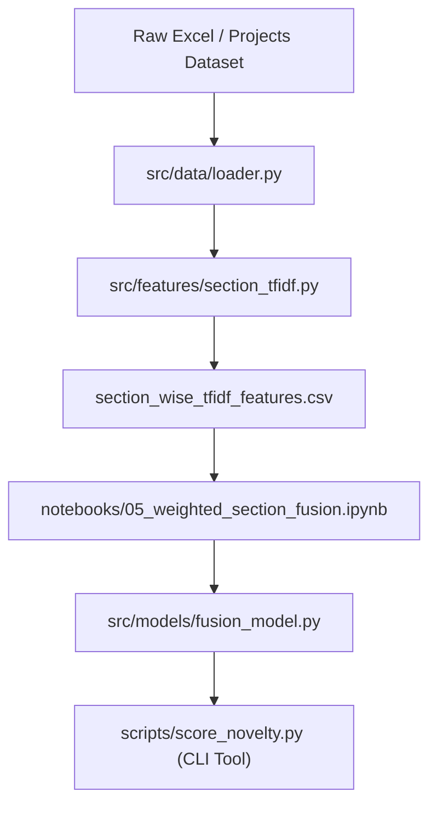

# Implementation Plan - Weighted Section Fusion, Codebase Modularization & Novelty Scoring CLI

Build out **Notebook 05 (`05_weighted_section_fusion.ipynb`)** for predicting academic project pair similarity, refactor the existing feature extraction and model code into a clean Python library in `src/`, and create CLI / API tools in `scripts/` to calculate the novelty score of new incoming project proposals.

## Goal Description

The project aims to detect novelty and similarity among academic computer science / data science projects by comparing text sections (title, abstract, problem statement, objectives, methodology, dataset, algorithm, technology tools).

Currently:
1. **Notebooks 01–04** conduct data exploration, TF-IDF baselines, section-wise TF-IDF feature extraction, and feature-label correlation analysis.
2. **Notebook 05** is an empty draft.
3. The codebase lacks a reusable Python library structure (`src/`) and CLI scripts (`scripts/`).

This plan covers:
- **Phase 1: Notebook 05 Implementation** — Machine Learning modeling (Regression & Classification), Weighted Section Fusion optimization (Constrained Least Squares / Ridge / Random Forest / XGBoost / Softmax weights), and model performance evaluation (RMSE, MAE, Pearson $r$, Spearman $\rho$, Accuracy, F1-Score).
- **Phase 2: Codebase Modularization (`src/`)** — Refactoring data loaders, text preprocessors, section-wise TF-IDF vectorizers, similarity calculators, and fusion models into a production-ready `src/` package.
- **Phase 3: CLI / API Tooling (`scripts/`)** — Creating CLI commands and scripts to score a new candidate project proposal against historical projects, generating a **Novelty Score** (\(1 - \text{max\_similarity}\)) and detailed section match breakdown.

---

## User Review Required

> [!IMPORTANT]
> **Modeling Strategy for Notebook 05**:
> We will evaluate both **Continuous Similarity Regression** (predicting expert label $0.0 - 4.0$) and **Multi-Class Classification** (predicting similarity categories $0, 1, 2, 3, 4$). Regression allows computing a continuous Novelty Score ($1.0 - \frac{\hat{y}}{4.0}$), while classification provides discrete risk levels.

> [!NOTE]
> **Section Fusion Weighting**:
> We will test:
> 1. Equal section weights baseline.
> 2. Learned linear weights via Non-Negative Least Squares (NNLS) / Ridge regression (enforcing non-negative weights that sum to 1.0).
> 3. Tree-based nonlinear fusion (Random Forest / Gradient Boosting / XGBoost).

---

## Open Questions

None currently. The user selected all 3 primary goals (Modeling, Modularization, CLI/API Tooling).

---

## Proposed Changes



---

### Phase 1: Notebook 05 — Weighted Section Fusion & Similarity Prediction

#### [NEW] [`notebooks/05_weighted_section_fusion.ipynb`](file:///D:/mega/academic-project-novelty-detection/notebooks/05_weighted_section_fusion.ipynb)
Implement full end-to-end section fusion notebook:
- **Data Loading**: Load extracted feature matrix (`results/feature_label_analysis/section_wise_tfidf_features.csv`).
- **Baselines**:
  - Unweighted Mean of section similarities.
  - TF-IDF Global Baseline similarity.
- **Optimization of Section Weights**:
  - Solve for section weights $w_i \ge 0$, $\sum w_i = 1$ minimizing MSE against `expert_similarity_label`.
  - Extract feature importances from Random Forest & Ridge.
- **Machine Learning Models**:
  - Regression: Ridge, Lasso, Random Forest Regressor, Gradient Boosting.
  - Classification: Logistic Regression, Random Forest Classifier, XGBoost / ExtraTrees.
- **Evaluation Metrics**:
  - Regression: RMSE, MAE, $R^2$, Pearson $r$, Spearman $\rho$.
  - Classification: Accuracy, Macro F1, Weighted F1, Confusion Matrix.
- **Novelty Score Formulation**:
  - Define $\text{Novelty Score} = 100\% \times (1 - \frac{\text{Predicted Similarity}}{4.0})$.
  - Analyze distribution of Novelty Scores across project pairs.

---

### Phase 2: Codebase Modularization (`src/`)

Create modular Python structure under `src/`:

```
src/
├── __init__.py
├── data/
│   ├── __init__.py
│   └── loader.py
├── features/
│   ├── __init__.py
│   ├── preprocessor.py
│   └── section_tfidf.py
├── models/
│   ├── __init__.py
│   └── fusion_model.py
└── utils/
    ├── __init__.py
    └── metrics.py
```

#### [NEW] [`src/data/loader.py`](file:///D:/mega/academic-project-novelty-detection/src/data/loader.py)
- `load_projects(filepath)`: Load raw Excel sheet of projects and preprocess text fields.
- `load_similarity_pairs(filepath)`: Load project pairs and expert ground-truth labels.
- `load_feature_dataset(filepath)`: Load precomputed section similarity features.

#### [NEW] [`src/features/section_tfidf.py`](file:///D:/mega/academic-project-novelty-detection/src/features/section_tfidf.py)
- `SectionTFIDFExtractor`: Class to fit TfidfVectorizers on 8 sections (`project_title`, `abstract`, `problem_statement`, `objectives`, `proposed_methodology`, `dataset`, `algorithm_model`, `technology_tools`).
- `compute_pair_similarities(projects_df, pairs_df)`: Compute pairwise cosine similarities per section.
- `transform_single_project(new_project_dict)`: Vectorize a single new project proposal for live scoring.

#### [NEW] [`src/models/fusion_model.py`](file:///D:/mega/academic-project-novelty-detection/src/models/fusion_model.py)
- `WeightedSectionFusionModel`: Wrapper model supporting linear weighted fusion (with non-negative weight constraints), Random Forest, and Gradient Boosting.
- `fit(X, y)` & `predict(X)` methods.
- `save_model(path)` & `load_model(path)` methods.

#### [NEW] [`src/utils/metrics.py`](file:///D:/mega/academic-project-novelty-detection/src/utils/metrics.py)
- `evaluate_regression(y_true, y_pred)`: Calculate MSE, RMSE, MAE, Pearson, Spearman.
- `evaluate_classification(y_true, y_pred)`: Calculate Accuracy, Macro F1, Confusion Matrix.
- `calculate_novelty_score(similarity_score)`: Compute percentage novelty score and risk level (High Novelty / Moderate Novelty / Low Novelty / Duplicate).

---

### Phase 3: CLI / API Interface for Novelty Scoring (`scripts/`)

#### [NEW] [`scripts/train.py`](file:///D:/mega/academic-project-novelty-detection/scripts/train.py)
- CLI script to run feature extraction, train section fusion models, save vectorizers & models to `models/section_fusion.joblib`, and output evaluation metrics.

#### [NEW] [`scripts/score_novelty.py`](file:///D:/mega/academic-project-novelty-detection/scripts/score_novelty.py)
- CLI tool to take a JSON/YAML file or command-line parameters representing a new candidate project proposal.
- Compares the candidate project against all historical projects in the database.
- Outputs top $K$ most similar existing projects, section breakdown, overall predicted similarity score, and calculated **Novelty Score**.

#### [NEW] [`scripts/run_pipeline.py`](file:///D:/mega/academic-project-novelty-detection/scripts/run_pipeline.py)
- Orchestration script to run full data loading, feature generation, model training, and validation.

---

## Verification Plan

### Automated Tests
- Run `train.py` script using python in `.venv` to verify vectorizers and model training work without error and output saved checkpoint:
  ```bash
  .venv\Scripts\python.exe scripts/train.py
  ```
- Run unit test / validation script verifying model predictions match expectations:
  ```bash
  .venv\Scripts\python.exe -c "import src; print('src package imported successfully')"
  ```

### Manual Verification
1. Open and execute `notebooks/05_weighted_section_fusion.ipynb` to check plot visualizations, loss curves, feature importance tables, and metric summaries.
2. Test CLI scoring script on a sample project input:
  ```bash
  .venv\Scripts\python.exe scripts/score_novelty.py --title "AI Based Crop Disease Detection using Vision Transformers" --abstract "This project proposes a novel transformer-based vision architecture..."
  ```
  Verify output includes:
  - Top 3 matching historical projects
  - Section-wise similarity breakdown
  - Overall Novelty Score (%) and Risk Level assessment.
