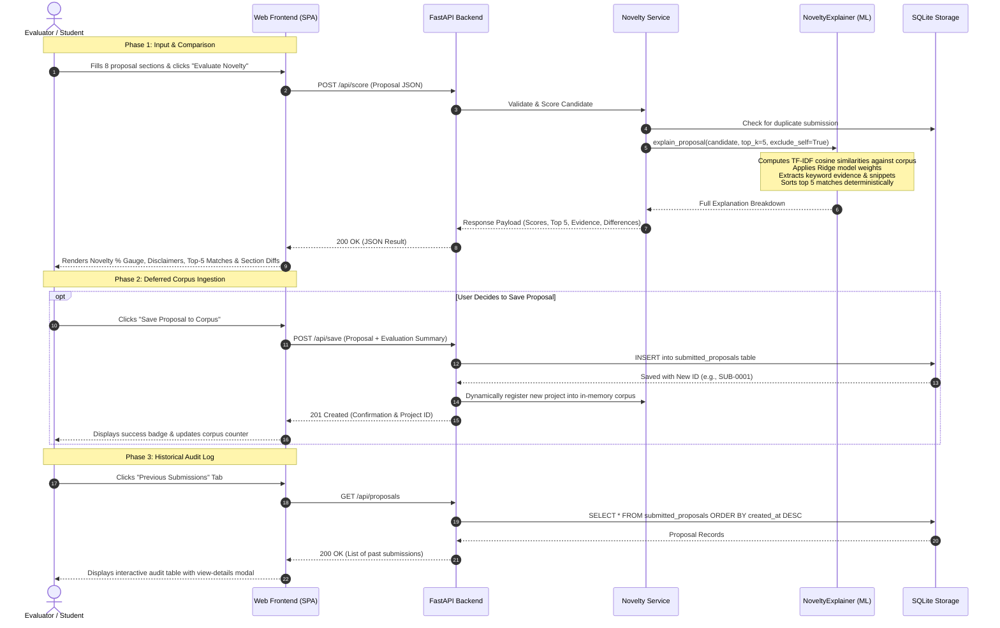

# Application Architecture Assessment & Plan

**Project:** `academic-project-novelty-detection`  
**Phase:** Application Architecture & System Design  
**Date:** October 22, 2026  
**Status:** Architecture Assessment Completed (Ready for Implementation)  

---

## 1. Executive Summary

This document presents the application architecture assessment and implementation roadmap for the Academic Project Novelty Detection System.
The objective of this phase is to build an interactive, production-ready, beginner-friendly web application that allows evaluators and students to submit academic project proposals, inspect corpus-relative novelty estimates, examine top historical matches with Explainable AI (XAI) evidence, review section-by-section differences, and save proposals to an indexed historical corpus.

All designs strictly enforce:
- **Zero model retraining or tuning:** Reuses the existing fitted TF-IDF extractors (`models/section_tfidf_extractor.joblib`) and Ridge fusion model (`models/ridge_fusion_model.joblib`).
- **Deferred, non-leaking corpus updates:** Submitted proposals are **never** stored into the comparison corpus prior to scoring; proposals are compared against the corpus first, and only appended to storage after evaluation completes and user confirmation is received.
- **Self-exclusion & duplicate suppression:** Evaluated proposals are excluded from their own historical candidate pool.
- **Corpus-relative disclaimers:** Novelty estimates are explicitly framed as relative heuristic scores against the reference database and do not claim to establish originality or prove plagiarism.

---

## 2. Existing Project Inspection

A comprehensive audit of the workspace reveals the following current state:

### 2.1 File & Directory Inventory
- **Model Checkpoints (`models/`):**
  - `section_tfidf_extractor.joblib` (2.0 MB): Fitted `SectionTFIDFExtractor` containing 8 fitted `TfidfVectorizer` models across the 8 sections for 600 baseline projects.
  - `ridge_fusion_model.joblib` (650 bytes): Fitted Ridge regression model ($b = -0.0706$, 8 section weights).
  - `hybrid_fusion_model.joblib` & `section_dense_extractor.joblib`: Backward-compatible dense embedding artifacts (retained, unmutated).
- **Explainability & Core Logic (`src/`):**
  - [`src/explainability/explainer.py`](file:///c:/Users/rajes/OneDrive/Desktop/PBL/academic-project-novelty-detection/src/explainability/explainer.py): Complete `NoveltyExplainer` engine supporting additive score reconstruction, whole-word-boundary snippet extraction, stop-word and low-information keyword filtering (`is_informative_term`), strict source verification, and self-exclusion.
  - [`src/features/section_tfidf.py`](file:///c:/Users/rajes/OneDrive/Desktop/PBL/academic-project-novelty-detection/src/features/section_tfidf.py): `SectionTFIDFExtractor` mapping the 8 proposal sections and computing candidate cosine similarity vectors against reference matrices.
  - [`src/data/loader.py`](file:///c:/Users/rajes/OneDrive/Desktop/PBL/academic-project-novelty-detection/src/data/loader.py): Excel loader for reference projects and similarity pairs.
  - [`src/utils/metrics.py`](file:///c:/Users/rajes/OneDrive/Desktop/PBL/academic-project-novelty-detection/src/utils/metrics.py): Formula for novelty percentage calculation and updated corpus-relative tier categorization (`"High estimated novelty relative to the current database"`).
- **Scripts (`scripts/`):**
  - [`scripts/score_novelty.py`](file:///c:/Users/rajes/OneDrive/Desktop/PBL/academic-project-novelty-detection/scripts/score_novelty.py): Fully functional CLI scoring utility supporting `--json_output`, `--top_k`, and non-causal attribution formatting.
- **Reference Data (`data/`):**
  - `data/raw/Academic_Project_Similarity_Synthetic_Dataset.xlsx`: 600 baseline historical projects.
  - `data/processed/similarity_pairs_clean.csv`: Cleaned pair dataset.
- **Test Suite (`tests/`):**
  - [`tests/test_xai.py`](file:///c:/Users/rajes/OneDrive/Desktop/PBL/academic-project-novelty-detection/tests/test_xai.py): 15 passing unit and integration tests covering scoring, clipping, snippet bounds, keyword filtering, and self-exclusion.
- **Git Status:**
  - Active branch: `main`. Clean working directory with non-destructive XAI test suite, metric tier updates, and CLI enhancements.

### 2.2 Server, API, & Frontend Status
- **Existing Server/API Code:** **None.** No FastAPI, Flask, or backend server exists yet.
- **Existing Frontend Code:** **None.** No web pages, UI templates, or frontend assets exist.
- **Existing Database:** **None.** Only raw Excel and CSV files exist.
- **Environment & Dependency Audit:**
  - `fastapi` (**0.135.3**), `uvicorn` (**0.44.0**), and `pydantic` (**2.12.5**) are **already installed and functional**.
  - `sqlite3` is available natively in the Python standard library.
  - `streamlit` is **not installed** in the local Python environment.

---

## 3. Recommended Architecture & Technology Stack

Given that **FastAPI**, **Uvicorn**, and **Pydantic** are already installed and tested in this environment, and `sqlite3` is built into Python, we recommend a clean, modular, and lightweight **Full-Stack Python + Modern Web Architecture**:

```
+----------------------------------------------------------------------------+
|                       WEB FRONTEND (Single Page App)                       |
|  - Modern Semantic HTML5 + Responsive Vanilla CSS (Glassmorphism / Cards)  |
|  - Modern Vanilla JavaScript (Fetch API, Tabs, Modals, Diff Visualizer)    |
|  - Served directly by FastAPI Static Files (Zero node/npm build needed)   |
+-------------------------------------+--------------------------------------+
                                      | HTTP REST (JSON)
                                      v
+----------------------------------------------------------------------------+
|                         BACKEND API (Python FastAPI)                       |
|  - Endpoints: /api/score, /api/save, /api/proposals, /api/health           |
|  - Validation: Pydantic schemas enforcing 8 proposal text sections         |
|  - Novelty Pipeline Service: Reuses NoveltyExplainer & SectionTFIDF        |
+-------------------+------------------------------------+-------------------+
                    |                                    |
                    v                                    v
+---------------------------------------+ +----------------------------------+
|           STORAGE (SQLite)            | |      ML & XAI INFERENCE          |
|  - data/proposals.db                  | |  - SectionTFIDFExtractor (joblib)|
|  - Stores newly submitted proposals   | |  - Ridge Fusion Model (joblib)   |
|  - Prevents duplicates & self-matches | |  - NoveltyExplainer (src/xai)    |
|  - Dynamically augments search corpus | |  - Top-5 Ranked Matches + XAI    |
+---------------------------------------+ +----------------------------------+
```

### 3.1 Technology Stack Selection
1. **Backend API:** **FastAPI + Uvicorn**
   - *Rationale:* FastAPI is already installed, lightweight, async-capable, self-documenting (`/docs` OpenAPI Swagger), and provides strict type-safe Pydantic request/response validation.
   - *Zero New Installs:* No new backend dependencies required.
2. **Persistent Storage:** **SQLite (`sqlite3`)**
   - *Rationale:* Built into Python standard library, serverless, atomic, single-file (`data/proposals.db`), zero maintenance overhead, perfectly suited for storing incoming academic submissions and metadata.
3. **Frontend:** **Modern Single Page Interface (Vanilla HTML5 / Modern CSS / Vanilla JS)**
   - *Rationale:* Served directly by FastAPI via `StaticFiles`. Requires zero Node.js/npm dependencies, zero build steps, and starts instantly with the backend. Enables custom side-by-side section diff views, radar/bar overlap visualizers, and interactive modals without the re-rendering constraints of Streamlit.
   - *Alternative (Streamlit):* If a pure-Python UI without HTML/JS is preferred by the user, Streamlit could be used; however, Streamlit is currently not installed (`pip install streamlit` would be needed) and is less flexible for detailed diff visualizations.
4. **Model & XAI Reuse:**
   - Directly instantiates `NoveltyExplainer` with the pre-fitted `SectionTFIDFExtractor` and `Ridge` model checkpoints. No model retraining, rewriting, or re-fitting is performed.

---

## 4. Proposed Directory Structure

```
academic-project-novelty-detection/
├── data/
│   ├── raw/
│   │   └── Academic_Project_Similarity_Synthetic_Dataset.xlsx  # 600 baseline projects (unmutated)
│   ├── processed/
│   │   └── similarity_pairs_clean.csv
│   └── proposals.db                                           # SQLite database for submitted proposals
├── models/
│   ├── section_tfidf_extractor.joblib                         # Pre-trained TF-IDF vectorizers (unmutated)
│   └── ridge_fusion_model.joblib                              # Pre-trained Ridge model (unmutated)
├── src/
│   ├── api/                                                   # [NEW] FastAPI application package
│   │   ├── __init__.py
│   │   ├── app.py                                             # Main FastAPI application & route mounting
│   │   ├── routes.py                                          # Endpoints: /score, /save, /proposals, /health
│   │   ├── schemas.py                                         # Pydantic request/response models
│   │   └── service.py                                         # Novelty scoring & corpus management service
│   ├── storage/                                               # [NEW] Proposal database management
│   │   ├── __init__.py
│   │   └── db.py                                              # SQLite database schemas and operations
│   ├── explainability/
│   │   ├── __init__.py
│   │   └── explainer.py                                       # Core XAI explainer (reused)
│   ├── features/
│   │   ├── __init__.py
│   │   └── section_tfidf.py                                   # TF-IDF feature extractor (reused)
│   └── utils/
│       ├── __init__.py
│       └── metrics.py                                         # Metric formulas and novelty tiers (reused)
├── static/                                                    # [NEW] Web Frontend Assets (served by FastAPI)
│   ├── index.html                                             # Semantic Single-Page Application interface
│   ├── css/
│   │   └── style.css                                          # Premium modern styles, dark/light themes
│   └── js/
│       ├── app.js                                             # Form submission, state management, API calls
│       └── diff_viewer.js                                     # Section comparison & difference renderer
├── scripts/
│   ├── run_app.py                                             # [NEW] Launch script (uvicorn server runner)
│   └── score_novelty.py                                       # Standalone CLI tool (retained)
├── tests/
│   ├── test_xai.py                                            # 15 XAI unit tests (retained)
│   └── test_api.py                                            # [NEW] FastAPI endpoint & database tests
└── results/
    ├── application/
    │   └── application_architecture_plan.md                   # This report
    └── xai/
        └── xai_implementation_report.md
```

---

## 5. End-to-End Data Flow

The application enforces a strict two-stage workflow where comparison precedes storage:



### Detailed Data Flow Stages:

1. **Stage 1: Input Validation**
   - User inputs 8 sections: `project_title`, `abstract`, `problem_statement`, `objectives`, `proposed_methodology`, `dataset`, `algorithm_model`, `technology_tools`.
   - Frontend and Pydantic schema ensure required sections are non-empty.
2. **Stage 2: Similarity & Novelty Calculation (Comparison)**
   - Backend calls `NoveltyExplainer.explain_proposal()` with `top_k=5` and `exclude_self=True`.
   - The comparison corpus includes the 600 baseline projects plus any previously committed submissions.
   - Ridge model computes unclipped `raw_similarity_prediction` and `predicted_similarity` clipped to $[0.0, 4.0]$.
   - Novelty score is calculated: $\text{Novelty } (\%) = 100 \times (1 - \text{predicted\_similarity} / 4.0)$.
   - Risk tier is determined (`High estimated novelty relative to the current database`, `Moderate Novelty`, `Low Novelty`, or `Very Low Novelty / Potential Duplicate`).
3. **Stage 3: Evidence Extraction & Difference Analysis**
   - Informative shared keywords and word-boundary snippets are extracted for each section.
   - For difference analysis, sections with low similarity ($< 0.15$) are flagged as *Differentiating Factors*, while sections with high similarity ($\ge 0.30$) are flagged as *Overlap Areas*.
4. **Stage 4: Client-Side Presentation**
   - Novelty score displayed with visual progress indicator.
   - Mandatory disclaimer displayed: *"Estimated heuristic relative to the current database. Does not establish originality or prove plagiarism."*
   - Cards display the top 5 matches with domain, predicted similarity, section overlap breakdown, and verified snippets.
   - Side-by-side text viewer allows evaluators to compare candidate text against any matched project section.
5. **Stage 5: Optional Deferred Ingestion (Storage)**
   - Proposal is **not** saved automatically.
   - When the user clicks *"Save Proposal to Corpus"*, `POST /api/save` writes the record to `data/proposals.db` with a timestamp and assigns a generated ID (e.g. `SUB-0001`).
   - The proposal is appended to the active in-memory corpus so subsequent candidate evaluations can match against it.
6. **Stage 6: Proposal Audit & Review**
   - Users can navigate to the *"Previous Submissions"* view (`GET /api/proposals`) to browse all historical submissions, filter by novelty tier, and re-inspect their evaluation reports.

---

## 6. Database Schema Design (SQLite)

The SQLite database (`data/proposals.db`) will contain a clean schema supporting proposal persistence and audit logs:

```sql
CREATE TABLE IF NOT EXISTS submitted_proposals (
    id INTEGER PRIMARY KEY AUTOINCREMENT,
    project_id TEXT UNIQUE NOT NULL,            -- e.g., 'SUB-0001'
    project_title TEXT NOT NULL,
    domain TEXT DEFAULT 'General',
    abstract TEXT NOT NULL,
    problem_statement TEXT NOT NULL,
    objectives TEXT NOT NULL,
    proposed_methodology TEXT NOT NULL,
    dataset TEXT NOT NULL,
    algorithm_model TEXT NOT NULL,
    technology_tools TEXT NOT NULL,
    max_similarity_score REAL NOT NULL,         -- Clipped similarity [0.0, 4.0]
    raw_similarity_score REAL NOT NULL,         -- Raw Ridge prediction
    novelty_score_pct REAL NOT NULL,            -- Percentage [0.0, 100.0]
    novelty_assessment_tier TEXT NOT NULL,      -- Risk tier string
    top_match_project_id TEXT,                  -- ID of closest historical project
    top_match_title TEXT,                       -- Title of closest historical project
    evaluation_json TEXT,                       -- Full structured explanation payload
    created_at TIMESTAMP DEFAULT CURRENT_TIMESTAMP
);

CREATE INDEX IF NOT EXISTS idx_proposals_title ON submitted_proposals(project_title);
CREATE INDEX IF NOT EXISTS idx_proposals_created ON submitted_proposals(created_at);
```

---

## 7. User Interface (Frontend) Specification

To provide an intuitive, beginner-friendly experience that fulfills all 8 workflow requirements, the frontend will feature a three-view tabbed layout:

### View 1: New Proposal Evaluation (`#evaluate-view`)
- **8-Section Input Form:** Clean, organized textareas with helpful placeholder prompts for each of the 8 academic sections.
- **Example Pre-fill Button:** One-click pre-fill with a sample proposal (e.g. Healthcare AI, Blockchain Supply Chain) to allow immediate demonstration.
- **Evaluation Action:** "Evaluate Novelty & Search Corpus" button with progress indicator.

### View 2: Novelty & Explainability Results (`#results-view`)
- **Top Summary Card:**
  - Novelty score gauge ($0\%$ to $100\%$) with color-coded risk badge.
  - Corpus relativity notice and non-plagiarism disclaimer.
  - Candidate metadata (title, evaluation timestamp, reference corpus count).
- **Top 5 Historical Matches:**
  - Accordion / Card list for the top 5 matching prior projects.
  - Per-match score breakdown: Intercept + Contributions = Predicted Similarity.
  - Section-level similarity bars comparing all 8 sections.
  - Key lexical evidence list with verified word-boundary source snippets.
- **Section Difference & Contrast Tool:**
  - Interactive side-by-side view highlighting distinguishing sections (unique methodology/dataset) vs overlapping sections.
- **Action Toolbar:**
  - "Save Proposal to Corpus" button (commits to SQLite and marks as saved).
  - "Export JSON Report" button.
  - "Evaluate Another Proposal" button.

### View 3: Historical Submissions Log (`#history-view`)
- **Submissions Table:** Lists all saved proposals with ID, title, domain, novelty score, closest match, and submission date.
- **Quick Inspect Modal:** View the complete stored XAI evaluation report for any past submission.

---

## 8. Dependencies & Environment Requirements

| Dependency | Purpose | Installed? | Notes |
|---|---|:---:|---|
| `fastapi` | REST API framework | **Yes** (v0.135.3) | Ready to use |
| `uvicorn` | ASGI web server | **Yes** (v0.44.0) | Ready to use |
| `pydantic` | Request/Response schema validation | **Yes** (v2.12.5) | Ready to use |
| `sqlite3` | Database engine | **Yes** (Standard lib) | Zero configuration |
| `scikit-learn` | Vectorizers & Ridge model | **Yes** (v1.8.0) | Reusing existing models |
| `joblib` | Model checkpoint loading | **Yes** (v1.6.0) | Checkpoints in `models/` |
| `pandas` / `numpy` | Dataframe manipulation | **Yes** | Ready to use |
| `HTML5 / CSS3 / JS` | Modern Single Page Frontend | **Yes** (Native web) | Zero external installs |

**Result:** The proposed architecture requires **zero new pip installations** and **zero Node.js dependencies**. Everything runs directly on the user's existing environment.

---

## 9. Implementation Roadmap

The implementation will proceed in 5 sequential steps:

```
[Step 1: Storage Layer]  ──> [Step 2: Backend API]   ──> [Step 3: Web Frontend]
   (SQLite DB & Init)          (FastAPI & Routes)          (HTML/CSS/JS SPA)
                                                                  │
[Step 5: Launch Script]  <── [Step 4: Integration Tests] <────────┘
   (run_app.py CLI)             (test_api.py 100% pass)
```

1. **Step 1: Database Storage Layer (`src/storage/db.py`)**
   - Implement `DatabaseManager` using Python's `sqlite3`.
   - Create table `submitted_proposals` with proper indexing.
   - Implement methods: `save_proposal()`, `get_all_proposals()`, `get_proposal_by_id()`, and `check_duplicate()`.
2. **Step 2: FastAPI Service & API Endpoints (`src/api/`)**
   - Create Pydantic schemas in `src/api/schemas.py` (`ProposalInput`, `ProposalEvaluationResponse`, `ProposalSaveResponse`, etc.).
   - Create `NoveltyService` in `src/api/service.py` to load models once at startup, orchestrate `NoveltyExplainer`, combine SQLite proposals into the active corpus, and compute section differences.
   - Implement endpoints in `src/api/routes.py`:
     - `POST /api/score`: Evaluates candidate without saving.
     - `POST /api/save`: Commits candidate to SQLite and updates active corpus.
     - `GET /api/proposals`: Lists all previous submissions.
     - `GET /api/proposals/{project_id}`: Retrieves full submission detail.
     - `GET /api/health`: Healthcheck and corpus statistics.
   - Mount static directory in `src/api/app.py`.
3. **Step 3: Web Frontend Interface (`static/`)**
   - Create `static/index.html` with semantic structure for proposal entry, results display, and history audit log.
   - Create `static/css/style.css` with a modern design system (responsive layout, curated palette, dark mode accents, accessible typography).
   - Create `static/js/app.js` and `static/js/diff_viewer.js` handling client state, API calls, dynamic chart/bars, and diff comparison.
4. **Step 4: Automated Integration Tests (`tests/test_api.py`)**
   - Write automated tests testing:
     - Proposal submission and scoring via FastAPI `TestClient`.
     - Exact additive reconstruction and score verification.
     - Deferred saving (verifying corpus is not mutated before save).
     - Duplicate detection and self-exclusion.
     - History listing and detail retrieval.
   - Run both existing 15 XAI tests and new API tests.
5. **Step 5: Launch & Verification Script (`scripts/run_app.py`)**
   - Create a single-command launcher script that starts the Uvicorn server and opens the browser.

---

## 10. Conclusion & Next Steps

This assessment demonstrates that the existing project assets (`explainer.py`, `section_tfidf.py`, `metrics.py`, and trained model checkpoints) are robust, tested, and ready to be integrated into an interactive web application.

Because FastAPI and Uvicorn are already present in the environment, building a FastAPI backend paired with an interactive modern Single Page Application and SQLite storage provides the fastest, most beginner-friendly, and most extensible foundation without introducing package bloat or external server dependencies.

Upon user confirmation of this architecture plan, implementation will begin with **Step 1 (Storage Layer)** and **Step 2 (FastAPI Service & Endpoints)**.
